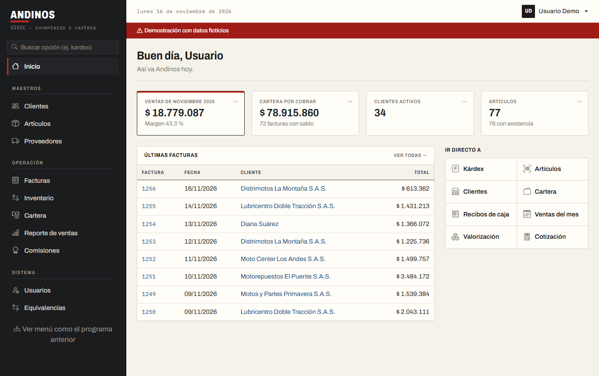
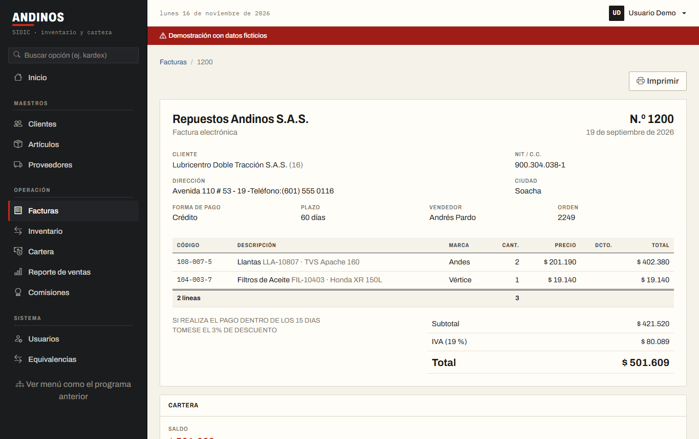
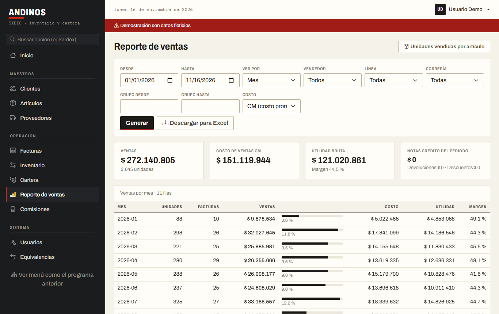

# Sidic Web

**Migration of a desktop ERP (VB.NET WinForms + Microsoft Access + Crystal Reports) to a Django web application.**
Invoicing with Colombian e-invoicing, inventory ledger with weighted average cost, accounts receivable, cash
receipts, import purchases, sales commissions and reporting for a motorcycle-parts distributor in Colombia.

*[Versión en español más abajo](#versión-en-español)*

### ▶ Live demo: **https://nedavefo.pythonanywhere.com/**

User `demo`, password `demo-sidic-2026` (administrator) · or `consulta` / `consulta-sidic-2026` (read-only).
You can create invoices, register payments and purchases; the data resets every day.

> The demo runs a made-up company ("Repuestos Andinos S.A.S.") with **100 % fictitious** customers, products and
> amounts, generated by a command of the system itself. It contains no real customer data.
> The user interface is in **Spanish**, as the system was built for a Colombian business.
> The source code is private because it belongs to a client project; **I'm happy to share it on request** for
> hiring processes.

## The problem

The company had been running for years on a desktop program written in VB.NET (WinForms) on top of a Microsoft
Access database, with reports in Crystal Reports. It worked, but:

- it could only be used on the office computers, with the Access file shared over the network;
- every report depended on Crystal Reports and a fragile installation on each machine;
- the business rules (pricing, costs, commissions, tax withholdings, e-invoicing) were spread across forms with
  thousands of lines and no tests;
- Access is not designed for several concurrent users or for working from outside the office.

**Sidic Web** replaces that program with a browser-based application that keeps the same rules and the same numbers
(document sequences, costs, balances) and can run alongside the legacy system during the transition (read-only
"coexistence mode").

## Features

| Module | What it does |
|---|---|
| **Customers & products** | Live search (htmx); customer and product pages with receivables, inventory ledger, yearly sales, imports and customer-specific prices; validation of the Colombian tax ID check digit (DIAN algorithm) and of product codes. |
| **Invoicing** | Invoices with price lists, discounts, freight and VAT; checks stock per product and per product group; in a single transaction it updates inventory, writes the ledger, creates the receivable and the sales history. Delivery notes, quotes, voiding and reprocessing. |
| **E-invoicing** | Generates the flat file for invoices, credit notes and debit notes in the format picked up by the certified e-invoicing provider's software for submission to the DIAN (Colombian tax authority), including the amount in words. |
| **Inventory** | Ledger (kárdex) per product and per group, weighted average cost with two cost books, import purchases and purchase voiding, quantity and price adjustments with history, valuation, turnover, audit and balance recalculation. |
| **Receivables** | Aging (0-30, 31-60, 61-90, 90+), cash receipts applied to several invoices with tax withholdings (income tax, VAT and municipal tax), credit and debit notes, reports by salesperson and region. |
| **Payables** | Suppliers and payables with automatic withholding calculation by transaction type. |
| **Reports** | Sales by month, salesperson, customer, group, product, line, sales route or city with cost, profit and margin; export to Excel. |
| **Commissions** | Commission base per salesperson following the business rules (credit sales, cash sales paid on time, bounced checks, freight, external representatives). |
| **Users & roles** | Administrator, Receivables, Warehouse, Purchasing and Read-only roles (combinable); every page requires login. |
| **Transition** | Menu organized "by area" or "like the legacy program", an option-by-option equivalence table, and a **read-only mode** that blocks data changes while the old system is still in use. |

## Screenshots (fictitious data)

| | |
|---|---|
|  |  |
| Login | Printable e-invoice |
|  |  |
| Receivables aging | Product inventory ledger |
|  |  |
| Product page with costs | Sales report with margin |

## Tech stack

- **Python 3.12 · Django 5.2** (function- and class-based views, forms, transactions, migrations)
- **htmx 2** for live search and partial table reloads without custom JavaScript
- **Bootstrap 5.3** with a custom "paper and ink" look (Archivo and IBM Plex Mono typefaces)
- **SQLite** in development and **PostgreSQL** in production
- **waitress** (WSGI server that runs on Windows) and **whitenoise** for static files
- Django test framework: **191 automated tests**
- Demo deployed on **PythonAnywhere**, with automatic daily data reset

## Notable technical decisions

- **Parity with the legacy system before "rewriting it nicely".** Every rule was taken from the VB.NET code and
  checked against documents produced by the old program: same invoice, same e-invoice file line by line, same
  average cost, same commission. The tests reproduce those cases.
- **Weighted average cost with two cost books.** Each purchase recalculates
  `(on hand × average + quantity × cost) / (on hand + quantity)` for both cost books, keeps the previous average so
  the purchase can be voided, and records the entry in the ledger and the import history.
- **The ledger as the source of truth.** Every inbound or outbound movement stores its running balance; a tool
  recalculates balances from a given date and shows the differences before applying them.
- **Atomic operations and gap-free document numbers.** Invoices, receipts and purchases run inside
  `transaction.atomic()` with `select_for_update()`: either everything is saved (inventory, ledger, receivables,
  history, sequence number) or nothing is.
- **E-invoicing as a flat file.** Instead of integrating an API, the system writes the same pipe-delimited file the
  e-invoicing provider already understood (header, detail and tax lines), with the exact rounding rule for each
  field and the amount written out in Spanish words.
- **Colombian number formats.** Users type `1.234.567,50`, `1234567.5` or `$ 50.000`; a single parser turns them
  into `Decimal` without ambiguity, and templates display `$ 1.234.568`. Money never goes through `float`.
- **Roles as Django groups created in code.** Roles and permissions are created on `migrate`;
  `LoginRequiredMiddleware` protects every page and a custom middleware implements the read-only mode.
- **Repeatable data migration.** A command imported the full Access database (via ODBC), validated integrity and
  produced a report; it could run every night while both systems coexisted.
- **Realistic demo data.** A command generates fictitious customers, products, purchases, invoices and receipts
  through the same services the screens use, so the ledger, costs and receivables always reconcile.
- **Production security.** Secrets only through environment variables, configurable HTTPS/HSTS, configurable admin
  URL, rotating error log and a backup command.

## Source code

The repository with the code is private. If you are evaluating my profile for a hiring process, get in touch
(details on my GitHub profile) and I will give you read access.

## Author

**Nexon David Veloza Forero** · [GitHub @Nedavefo](https://github.com/Nedavefo)

---

## Versión en español

**Migración de un ERP de escritorio (VB.NET WinForms + Microsoft Access + Crystal Reports) a una aplicación web
con Django.** Facturación con factura electrónica, inventario con kárdex y costo promedio, cartera, recibos de caja,
compras de importación, comisiones y reportes para una distribuidora de repuestos y accesorios para moto.

**Demostración en vivo:** https://nedavefo.pythonanywhere.com/ · usuario `demo`, contraseña `demo-sidic-2026`
(administrador) o `consulta` / `consulta-sidic-2026` (solo consulta). Los datos se restablecen cada día.

> La demostración usa una empresa inventada ("Repuestos Andinos S.A.S.") con clientes, artículos y valores
> **100 % ficticios**. No contiene datos de ningún cliente real. El código fuente es privado porque pertenece a un
> proyecto para un cliente; **lo comparto con gusto bajo solicitud** para procesos de selección.

### El problema

La empresa trabajaba desde hacía años con un programa de escritorio hecho en VB.NET (WinForms) sobre una
base de datos Access, con los informes en Crystal Reports. Funcionaba, pero:

- solo se podía usar en los computadores de la oficina, con la base Access compartida en la red;
- cada informe dependía de Crystal Reports y de una instalación delicada en cada equipo;
- las reglas de negocio (precios, costos, comisiones, retenciones, factura electrónica) estaban repartidas en
  formularios de miles de líneas, sin pruebas;
- Access no es una base pensada para varios usuarios a la vez ni para trabajar desde fuera de la oficina.

**Sidic Web** reemplaza ese programa por una aplicación web que se usa desde el navegador, conserva las mismas
reglas y los mismos números (consecutivos, costos, saldos) y puede convivir con el sistema anterior durante la
transición (modo consulta).

### Qué hace

| Módulo | Funcionalidades |
|---|---|
| **Clientes y artículos** | Búsqueda en vivo (htmx), fichas con cartera, kárdex, ventas por año, importaciones y precios especiales por cliente; validación del dígito de verificación del NIT (algoritmo DIAN) y del código de artículo. |
| **Facturación** | Factura con listas de precios, descuentos, fletes e IVA; valida existencias del artículo y del grupo; en una sola transacción descuenta inventario, escribe el kárdex, crea la cuenta por cobrar y el histórico de ventas. Remisiones, cotizaciones, anulación y reproceso. |
| **Factura electrónica** | Genera el archivo plano de factura, nota crédito y nota débito con el formato que recoge el software del proveedor tecnológico para enviarlo a la DIAN, incluido el valor en letras. |
| **Inventario** | Kárdex por artículo y por grupo, costo promedio ponderado con dos juegos de costos, compras de importación, anulación de compras, ajustes de cantidades y precios con historial, valorización, rotación, auditoría y recálculo de saldos. |
| **Cartera** | Cuentas por cobrar por edades (0-30, 31-60, 61-90, +90), recibos de caja con abonos a varias facturas y retenciones (ReteFuente, ReteIVA, ReteICA), notas crédito y débito, reportes por vendedor y zona. |
| **Cuentas por pagar** | Proveedores y cuentas por pagar con cálculo automático de retenciones según el tipo de operación. |
| **Reportes** | Ventas por mes, vendedor, cliente, grupo, artículo, línea, correría o ciudad con costo, utilidad y margen; descarga para Excel. |
| **Comisiones** | Base de comisión por vendedor con las reglas del negocio (crédito, contado pagado a tiempo, cheques devueltos, fletes, representantes). |
| **Usuarios y roles** | Roles Administrador, Cartera, Bodega, Compras y Consulta (combinables); toda página exige sesión. |
| **Transición** | Menú "por áreas" o "como el programa anterior", tabla de equivalencias opción por opción y **modo consulta** que bloquea lo que modifica datos mientras se sigue usando el sistema viejo. |

Las capturas están en la sección en inglés de arriba.

### Stack

- **Python 3.12 · Django 5.2** (vistas basadas en funciones y clases, formularios, transacciones, migraciones)
- **htmx 2** para búsquedas en vivo y tablas que se recargan sin JavaScript propio
- **Bootstrap 5.3** con un estilo propio "papel y tinta" (tipografías Archivo e IBM Plex Mono)
- **SQLite** en desarrollo y **PostgreSQL** en producción
- **waitress** (servidor WSGI que corre en Windows) y **whitenoise** para los archivos estáticos
- Pruebas con el framework de Django: **191 pruebas** automáticas
- Demostración desplegada en **PythonAnywhere**, con restablecimiento automático diario de los datos

### Decisiones técnicas interesantes

- **Paridad con el sistema anterior antes que "reescribir bonito".** Cada regla se tomó del código VB.NET y se
  comprobó contra documentos generados por el programa viejo: misma factura, mismo archivo electrónico línea por
  línea, mismo costo promedio, misma comisión. Las pruebas reproducen esos casos.
- **Costo promedio ponderado con dos juegos de costos.** Cada compra recalcula
  `(disponible × promedio + cantidad × costo) / (disponible + cantidad)` para los dos juegos de costos, guarda el
  promedio anterior para poder anular la compra y deja la entrada en el kárdex y en el histórico de importaciones.
- **Kárdex como fuente de verdad.** Toda entrada o salida deja un movimiento con su saldo; hay una herramienta que
  recalcula los saldos desde una fecha y muestra las diferencias antes de aplicarlas.
- **Operaciones atómicas y consecutivos sin huecos.** Facturar, registrar recibos o compras ocurre dentro de
  `transaction.atomic()` con `select_for_update()`: o queda todo (inventario, kárdex, cartera, histórico,
  consecutivo) o no queda nada.
- **Factura electrónica en formato texto.** En lugar de integrar un API, el sistema escribe el mismo archivo
  plano separado por `|` que ya entendía el proveedor tecnológico (encabezado, detalle e impuestos), con el
  redondeo exacto de cada campo y el valor en letras en español.
- **Números con formato colombiano.** Los usuarios escriben `1.234.567,50`, `1234567.5` o `$ 50.000`; un único
  intérprete los convierte a `Decimal` sin ambigüedad y las plantillas muestran `$ 1.234.568`. Los valores de
  dinero nunca pasan por `float`.
- **Roles con grupos de Django creados por código.** Los roles y sus permisos se crean al correr `migrate`;
  `LoginRequiredMiddleware` protege todas las páginas y un middleware propio implementa el modo consulta.
- **Migración de datos repetible.** Un comando importaba la base Access completa (vía ODBC), validaba integridad y
  dejaba un informe; se podía correr todas las noches mientras ambos sistemas convivían.
- **Datos de demostración realistas.** Un comando genera clientes, artículos, compras, facturas y recibos
  ficticios usando los mismos servicios de las pantallas, así el kárdex, los costos y la cartera quedan cuadrados.
- **Seguridad de producción.** Secretos solo por variables de entorno, HTTPS/HSTS configurables, ruta del panel de
  administración configurable, registro de errores rotativo y comando de respaldos.

### Código fuente

El repositorio con el código es privado. Si estás evaluando mi perfil para un proceso de selección, contáctame
(datos en mi perfil de GitHub) y te doy acceso de lectura.

### Autor

**Nexon David Veloza Forero** · [GitHub @Nedavefo](https://github.com/Nedavefo)
