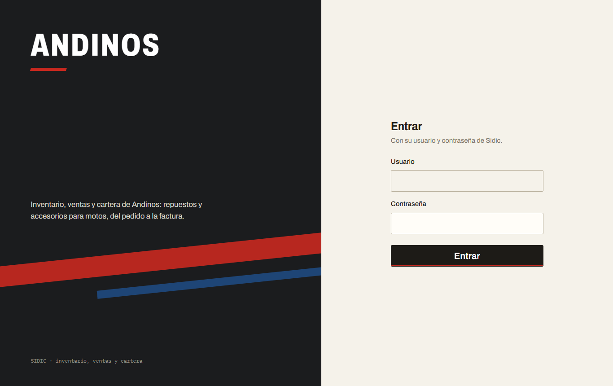
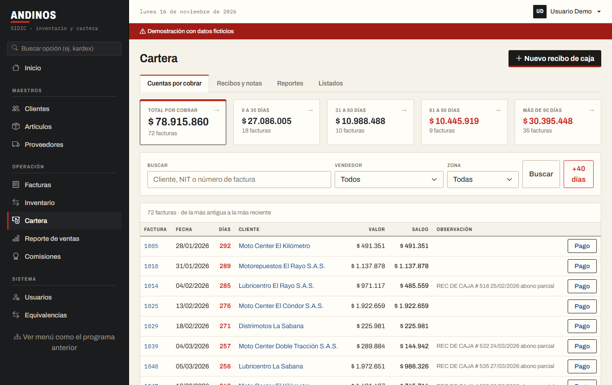
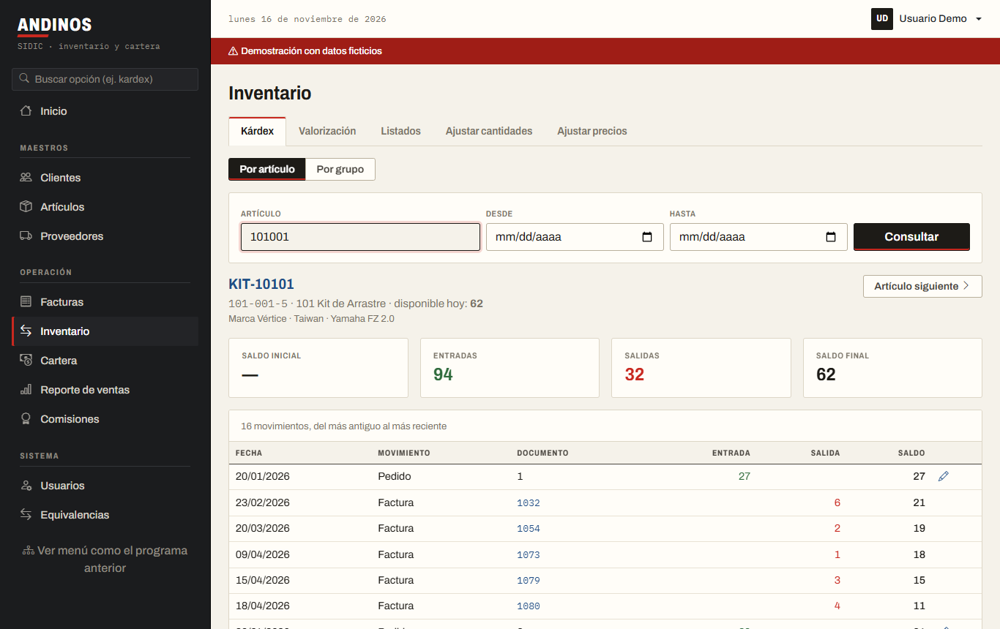
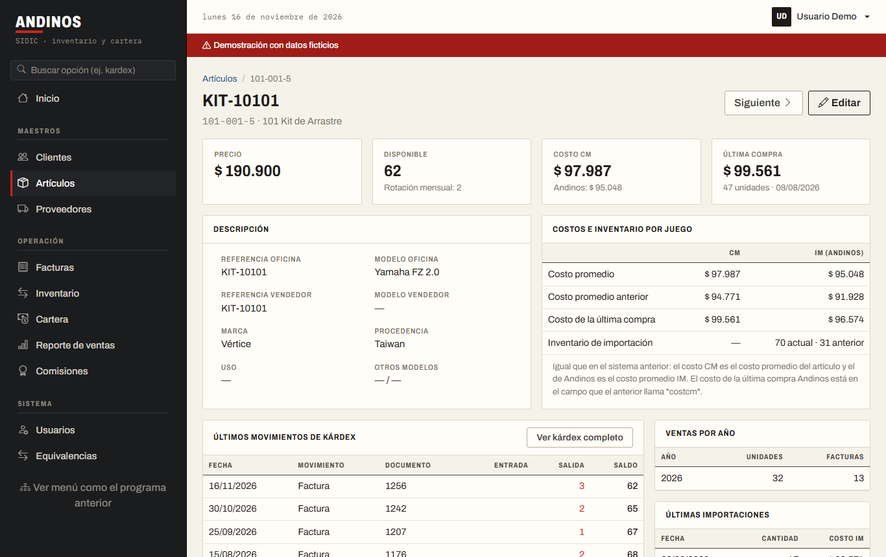

# Sidic Web

**Migración de un ERP de escritorio (VB.NET WinForms + Microsoft Access + Crystal Reports) a una aplicación web
con Django.** Facturación con factura electrónica, inventario con kárdex y costo promedio, cartera, recibos de caja,
compras de importación, comisiones y reportes para una distribuidora de repuestos y accesorios para moto.

### ▶ Demostración en vivo: **https://nedavefo.pythonanywhere.com/**

Usuario `demo`, contraseña `demo-sidic-2026` (administrador) · o `consulta` / `consulta-sidic-2026` (solo consulta).
Se puede facturar, registrar recibos y compras; los datos se restablecen cada día.

> La demostración usa una empresa inventada ("Repuestos Andinos S.A.S.") con clientes, artículos y valores
> **100 % ficticios**, generados por un comando del propio sistema. No contiene datos de ningún cliente real.
> El código fuente es privado porque pertenece a un proyecto para un cliente; **lo comparto con gusto bajo
> solicitud** para procesos de selección.

*[English summary below](#english-summary)*

---

## El problema

La empresa trabajaba desde hacía años con un programa de escritorio hecho en VB.NET (WinForms) sobre una
base de datos Access, con los informes en Crystal Reports. Funcionaba, pero:

- solo se podía usar en los computadores de la oficina, con la base Access compartida en la red;
- cada informe dependía de Crystal Reports y de una instalación delicada en cada equipo;
- las reglas de negocio (precios, costos, comisiones, retenciones, factura electrónica) estaban repartidas en
  formularios de miles de líneas, sin pruebas;
- Access no es una base pensada para varios usuarios a la vez ni para trabajar desde fuera de la oficina.

**Sidic Web** reemplaza ese programa por una aplicación web que se usa desde el navegador, conserva las mismas
reglas y los mismos números (consecutivos, costos, saldos) y puede convivir con el sistema anterior durante la
transición (modo consulta).

## Qué hace

| Módulo | Funcionalidades |
|---|---|
| **Clientes y artículos** | Búsqueda en vivo (htmx), fichas con cartera, kárdex, ventas por año, importaciones y precios especiales por cliente; validación del dígito de verificación del NIT (algoritmo DIAN) y del código de artículo. |
| **Facturación** | Factura con listas de precios, descuentos, fletes e IVA; valida existencias del artículo y del grupo; en una sola transacción descuenta inventario, escribe el kárdex, crea la cuenta por cobrar y el histórico de ventas. Remisiones, cotizaciones, anulación y reproceso. |
| **Factura electrónica** | Genera el archivo plano de factura, nota crédito y nota débito con el formato que recoge el software del proveedor tecnológico para enviarlo a la DIAN, incluido el valor en letras. |
| **Inventario** | Kárdex por artículo y por grupo, costo promedio ponderado con dos juegos de costos, compras de importación, anulación de compras, ajustes de cantidades y precios con historial, valorización, rotación, auditoría y recálculo de saldos. |
| **Cartera** | Cuentas por cobrar por edades (0-30, 31-60, 61-90, +90), recibos de caja con abonos a varias facturas y retenciones (ReteFuente, ReteIVA, ReteICA), notas crédito y débito, reportes por vendedor y zona. |
| **Cuentas por pagar** | Proveedores y cuentas por pagar con cálculo automático de retenciones según el tipo de operación. |
| **Reportes** | Ventas por mes, vendedor, cliente, grupo, artículo, línea, correría o ciudad con costo, utilidad y margen; descarga para Excel. |
| **Comisiones** | Base de comisión por vendedor con las reglas del negocio (crédito, contado pagado a tiempo, cheques devueltos, fletes, representantes). |
| **Usuarios y roles** | Roles Administrador, Cartera, Bodega, Compras y Consulta (combinables); toda página exige sesión. |
| **Transición** | Menú "por áreas" o "como el programa anterior", tabla de equivalencias opción por opción y **modo consulta** que bloquea lo que modifica datos mientras se sigue usando el sistema viejo. |

## Capturas (datos ficticios)

| | |
|---|---|
|  |  |
| Inicio de sesión | Factura electrónica imprimible |
|  |  |
| Cartera por edades | Kárdex de un artículo |
|  |  |
| Ficha de artículo con costos | Reporte de ventas con margen |

## Stack

- **Python 3.12 · Django 5.2** (vistas basadas en funciones y clases, formularios, transacciones, migraciones)
- **htmx 2** para búsquedas en vivo y tablas que se recargan sin JavaScript propio
- **Bootstrap 5.3** con un estilo propio "papel y tinta" (tipografías Archivo e IBM Plex Mono)
- **SQLite** en desarrollo y **PostgreSQL** en producción
- **waitress** (servidor WSGI que corre en Windows) y **whitenoise** para los archivos estáticos
- Pruebas con el framework de Django: **191 pruebas** automáticas
- Demostración desplegada en **PythonAnywhere**, con restablecimiento automático diario de los datos

## Decisiones técnicas interesantes

- **Paridad con el sistema anterior antes que "reescribir bonito".** Cada regla se tomó del código VB.NET y se
  comprobó contra documentos generados por el programa viejo: misma factura, mismo archivo electrónico línea por
  línea, mismo costo promedio, misma comisión. Las pruebas reproducen esos casos.
- **Costo promedio ponderado con dos juegos de costos.** Cada compra recalcula
  `(disponible × promedio + cantidad × costo) / (disponible + cantidad)` para los dos juegos de costos, guarda el
  promedio anterior para poder anular la compra y deja la entrada en el kárdex y en el histórico de importaciones.
- **Kárdex como fuente de verdad.** Toda entrada o salida deja un movimiento con su saldo; hay una herramienta que
  recalcula los saldos desde una fecha y muestra las diferencias antes de aplicarlas.
- **Operaciones atómicas y consecutivos sin huecos.** Facturar, registrar recibos o compras ocurre dentro de
  `transaction.atomic()` con `select_for_update()`: o queda todo (inventario, kárdex, cartera, histórico,
  consecutivo) o no queda nada.
- **Factura electrónica en formato texto.** En lugar de integrar un API, el sistema escribe el mismo archivo
  plano separado por `|` que ya entendía el proveedor tecnológico (encabezado, detalle e impuestos), con el
  redondeo exacto de cada campo y el valor en letras en español.
- **Números con formato colombiano.** Los usuarios escriben `1.234.567,50`, `1234567.5` o `$ 50.000`; un único
  intérprete los convierte a `Decimal` sin ambigüedad y las plantillas muestran `$ 1.234.568`. Los valores de
  dinero nunca pasan por `float`.
- **Roles con grupos de Django creados por código.** Los roles y sus permisos se crean al correr `migrate`;
  `LoginRequiredMiddleware` protege todas las páginas y un middleware propio implementa el modo consulta.
- **Migración de datos repetible.** Un comando importaba la base Access completa (vía ODBC), validaba integridad y
  dejaba un informe; se podía correr todas las noches mientras ambos sistemas convivían.
- **Datos de demostración realistas.** Un comando genera clientes, artículos, compras, facturas y recibos
  ficticios usando los mismos servicios de las pantallas, así el kárdex, los costos y la cartera quedan cuadrados.
- **Seguridad de producción.** Secretos solo por variables de entorno, HTTPS/HSTS configurables, ruta del panel de
  administración configurable, registro de errores rotativo y comando de respaldos.

## Código fuente

El repositorio con el código es privado. Si estás evaluando mi perfil para un proceso de selección, contáctame
(datos en mi perfil de GitHub) y te doy acceso de lectura.

## Autor

**Nexon David Veloza Forero** · [GitHub @Nedavefo](https://github.com/Nedavefo)

---

## English summary

**Sidic Web** is the migration of a long-running desktop ERP (VB.NET WinForms + Microsoft Access + Crystal Reports)
used by a motorcycle-parts distributor into a **Django 5.2** web application.

- **Live demo:** https://nedavefo.pythonanywhere.com/ — log in as `demo` / `demo-sidic-2026` (100 % fictitious
  data, resets daily).
- **Features:** invoicing with Colombian e-invoicing flat-file export, inventory ledger (kárdex) with weighted
  average cost, accounts receivable with aging and cash receipts with tax withholdings, import purchases, sales
  reports with margins, sales commissions, role-based access, and a read-only "coexistence mode" for running
  alongside the legacy system.
- **Stack:** Python 3.12, Django 5.2, htmx, Bootstrap 5, SQLite/PostgreSQL, waitress, whitenoise, PythonAnywhere.
- **Highlights:** behavior parity with the legacy system verified by tests that reproduce real legacy documents,
  atomic operations with row locking for gap-free document numbers, `Decimal`-only money handling with a parser
  for Colombian number formats, and 191 automated tests.
- **Source code:** private (client project); available on request for hiring processes.
